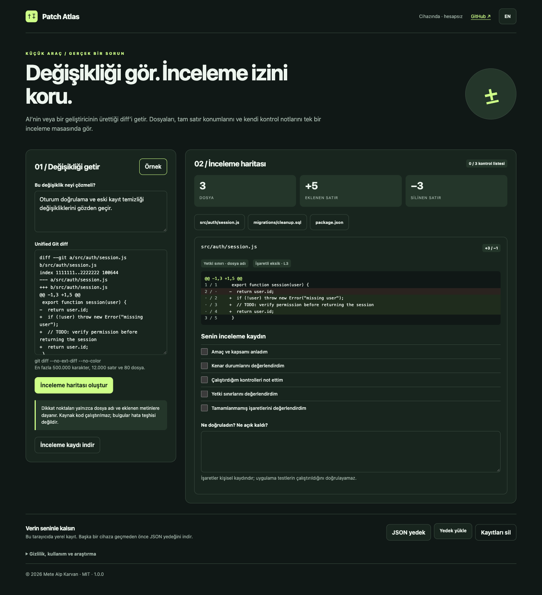

# Patch Atlas

AI veya bir geliştirici tarafından yazılan değişiklikler için yerel inceleme masası. Unified diff getir, eski/yeni satır konumlarını gör ve kendi inceleme izini sakla.

[Canlı uygulama](https://metealpkarvan.github.io/patch-atlas/) · [İndir](https://github.com/metealpkarvan/patch-atlas/releases/latest) · [English](README.md)

## Özellikler

- Eski/yeni satır numaraları, Türkçe dosya adları, yeniden adlandırma ve mod değişikliklerini destekleyen diff haritası.
- Dosya adı ve eklenen metinlerden türetilen yedi açıklanabilir dikkat noktası.
- Amaç alanı, dosya gezgini, kontrol listeleri ve dosya başına inceleme notları.
- Markdown inceleme kaydı ve JSON yedekleri; diff değiştiğinde eski işaretler onayla sıfırlanır.

## Başla

1. **Örnek** ile kurgusal üç dosyalık değişikliği aç.
2. `git diff --no-ext-diff --no-color` çıktısını getir, amacı yaz ve haritayı oluştur.
3. Bir dosya seç, satırları incele, yaptığın kontrolleri ve açık kalan konuları not et.
4. İnceleme kaydını veya tam JSON yedeğini indir.

İndirilen ZIP'i çıkarıp **index.html** dosyasını güncel tarayıcında açabilirsin. Paket hazırlanmış JavaScript içerir; Node.js, sunucu veya API anahtarı gerekmez. Canlı uygulama daha öngörülebilir tarayıcı kaydı sağlar. İndirilen klasörü taşımadan veya canlı uygulamaya geçmeden önce JSON yedeğini indir; `file:` sayfalarının yerel kayıt davranışı tarayıcıya ve konuma göre değişebilir.

## Veriler ve sınırlar

En fazla 500.000 karakter, 12.000 satır ve 80 dosyalık iki yönlü unified diff desteklenir. Birleşik merge diff ve eksik hunk reddedilir. İkili içerik başka araçla incelenir. Dikkat noktaları metin kurallarıdır; yanlış pozitif üretebilir ve hata teşhisi veya birleştirme onayı değildir. Uygulama depo taramaz, kod çalıştırmaz veya testlerin çalıştığını doğrulamaz.

Kayıtların bu tarayıcıda saklanır ve şifreli değildir. Hesap, bulut eşitleme, analitik veya AI API çağrısı yoktur. Tarayıcı verilerini silmek kayıtları da silebilir. Bozuk kayıt üzerine yazma engellenir; orijinal kaydı indirme seçeneği vardır. Yedek yüklemeden önce içerik doğrulanır ve onaydan sonra mevcut verilerin kurtarma kopyası indirilir. JSON içe aktarımı 3 MB ile sınırlıdır.

Canlı uygulama ilk çevrimiçi açılıştan sonra arayüzünü çevrimdışı açabilir. Bağlantı verdiğin siteler önbelleğe alınmaz. Türkçe/İngilizce geçişi düğmeleri çevirir; senin yazdığın içerikleri değiştirmez.

## Araştırma ve doğrulama

5 Ekim 2026'da erişilen üç X gönderisi ve sekiz Reddit tartışmasından türetilen tasarım varsayımları [araştırma kaydında](docs/COMMUNITY-RESEARCH-2026-10-05.md) açıklanır. Eksik X metinleri, tarih belirsizliği ve ürün tanıtımı içeren kaynaklar açıkça işaretlidir. Kullanıcı testiyle ölçülmüş fayda veya toplumun tamamına dair genelleme yoktur.

**37 otomatik kural/paket kontrolü**, gerçek tarayıcı kullanım akışları, mobil görünüm ve çevrimdışı açılış kontrol edildi. CI, Intel ve Apple Silicon üzerinde yerel Node.js ile çalışır. Uygulama her iki Mac türünde modern tarayıcıyla açılır; Rosetta gerekmez. Geliştirme için Node.js 22+, isteğe bağlı yerel sunucu için Python 3 kullanılır.

MIT · Mete Alp Karvan
